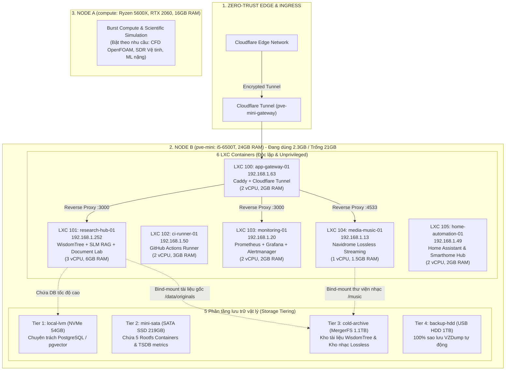

# Plank Platform

> **Control repository** cho private homelab platform: Proxmox infrastructure, VM/LXC lifecycle (Terraform), OS configuration (Ansible), zero-trust ingress và computational engineering.

---

## 1. Architecture Overview

Hệ thống vận hành trên 2 Proxmox node độc lập với ranh giới trách nhiệm rõ ràng:

* **Node B (`pve-mini` — Intel i5-6500T, 24GB RAM):**
  * **Vai trò:** Always-On Foundation & Knowledge Hub (24/7).
  * **Workloads:**
    * `LXC 100` (`app-gateway`): Caddy + Cloudflare Tunnel (Ingress an toàn, không mở port router).
    * `LXC 101` (`research-hub`): WisdomTree (Next.js 16 + Postgres 16 trên NVMe) + Live SLM RAG + Document Lab (LaTeX / Calibre-Web).
    * `LXC 102` (`ci-runner`): GitHub Actions Self-Hosted Runner (Automated CD).
    * `LXC 103` (`monitoring`): Lean Observability (Prometheus TSDB + Grafana + Alertmanager).
    * `LXC 104` (`media-music`): Navidrome Lossless Streaming.
    * `LXC 105` (`home-automation`): Home Assistant & Smarthome Hub (Zigbee/MQTT/Core).
  * **Storage:** Phân tầng 5 cấp (NVMe cho DB, SATA SSD cho Apps, MergerFS 1.1TB cho Bulk Media, USB HDD cho Backup).

* **Node A (`compute` — Ryzen 5 5600X, RTX 2060 6GB, 16GB RAM):**
  * **Vai trò:** Burst Compute & Scientific Simulation (Kích hoạt theo đợt).
  * **Workloads:** Mô phỏng khí động học (OpenFOAM / SU2 CFD), thu thập dữ liệu vô tuyến vệ tinh (RTL-SDR / NOAA), Machine Learning mô phỏng môi trường.

---

## 2. Platform Boundaries

* **Terraform:** Quản lý vòng đời tài nguyên (*Resource lifecycle*: LXC, VM, CPU, RAM, Disk, Storage Tiers).
* **Ansible:** Quản lý cấu hình hệ điều hành (*Machine configuration*: Packages, runtimes, configs).
* **Caddy + Cloudflare Tunnel:** Quản lý Ingress và bảo mật Edge (*Zero open ports, auto HTTPS*).
* **Git:** Single source of truth cho toàn bộ hạ tầng.

---

## 3. Repository Structure

```text
homelab/
├── terraform/
│   └── nodes/
│       ├── node-mini1/      # Quản lý Node B (pve-mini)
│       │   ├── main.tf
│       │   ├── provider.tf
│       │   ├── variables.tf
│       │   └── terraform.tfvars.example
│       └── node-compute1/   # Quản lý Node A (Ryzen 5600X + RTX 2060)
├── ansible/                 # Cấu hình máy chủ tự động
└── roadmap.md               # Chi tiết toàn bộ blueprint và tiến độ triển khai
```

---

## 4. Quickstart (Terraform)

```bash
cd terraform/nodes/node-mini1

# 1. Tạo file cấu hình từ template mẫu:
cp terraform.tfvars.example terraform.tfvars

# 2. Cập nhật Proxmox API token, endpoint, SSH key vào terraform.tfvars

# 3. Khởi tạo và triển khai:
terraform init
terraform plan
terraform apply
```

> Chi tiết toàn bộ thiết kế kiến trúc và lộ trình từng bước: xem [roadmap.md](roadmap.md).

---

## 5. System Topology


